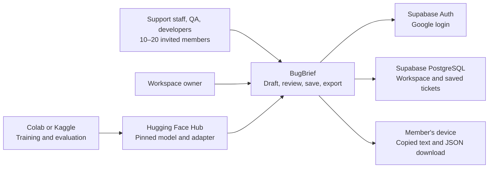
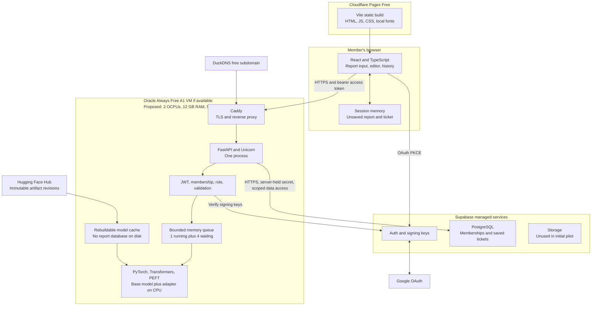
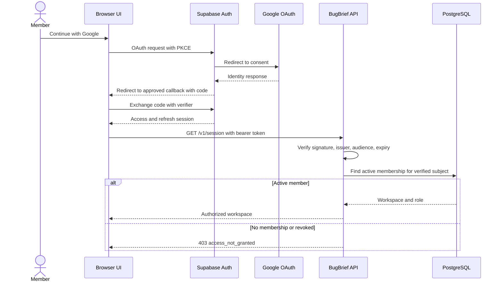
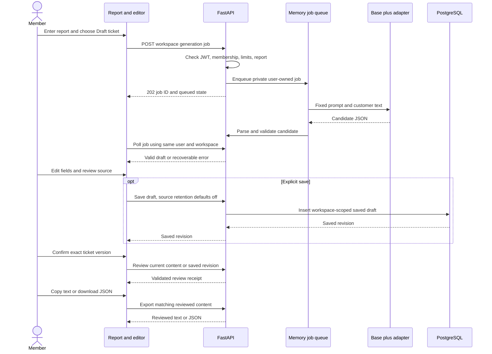
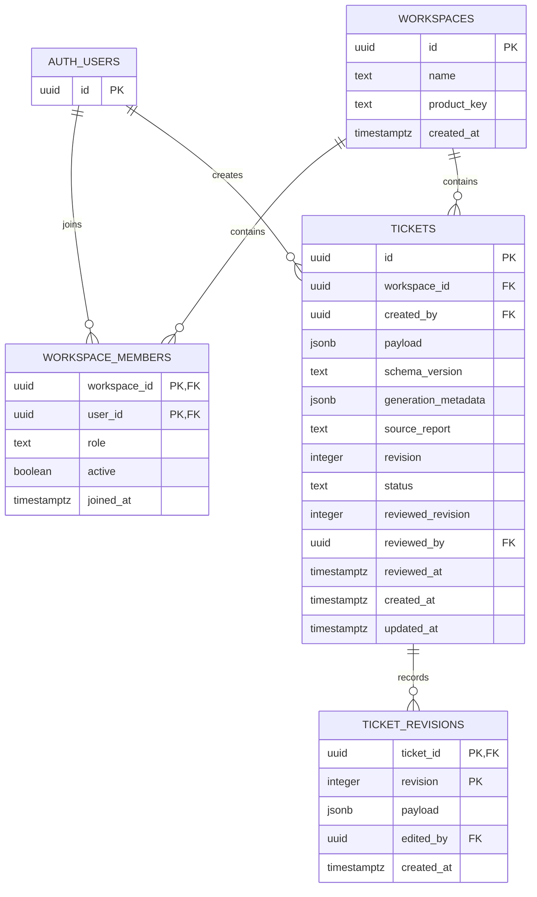
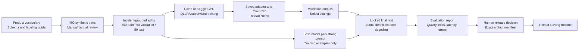

# BugBrief System Architecture

Status: proposed implementation plan. Updated: 13 October 2026.

This document defines a small, authenticated BugBrief pilot for 10–20 people in a software house. It covers the application, model lifecycle, data, deployment, interfaces, and verification needed before launch. The first local implementation is now available; no cloud resources have been created. See [Implementation.md](Implementation.md) for verified behavior and remaining work.

The downloaded v2 adapter is now the selected local inference candidate. See [V2_Pipeline.md](V2_Pipeline.md) for artifact verification, CPU runtime options, constrained JSON, source-comparison hints, and the review/export flow. Saved validation results do not establish factual quality or concurrency capacity for this serving configuration.

Read [Design.md](Design.md) for the screens, visual system, components, and interaction rules. The product source is [BugBrief_Project_Description.docx](../BugBrief_Project_Description.docx). The requested filename `Architecutr.md` is retained.

## 1. Requirements and decisions

### Confirmed context

- Turn short English bug reports into editable developer tickets for fictional LedgerFlow.
- Product areas: Authentication, Billing, Dashboard, Integrations, and Unknown.
- Preserve reported facts, expose inference, and ask at most three clarification questions.
- Train an adapter for Qwen2.5-1.5B-Instruct and compare it with the same base model under a strong prompt.
- Use synthetic data: 300 training, 50 validation, and 50 test examples.
- Provide login for 10–20 users and prefer free deployment and a free database.
- Train in a free Colab or Kaggle notebook, subject to GPU availability.
- Use a compact dark workspace with charcoal and grey surfaces and a suitable accent.
- Use invite-only Google login, shared saved tickets, and no automatic original-report saving; the user accepted this recommendation.
- An eligible Hugging Face account is available for a ZeroGPU hosting experiment.

### Recommended decisions

| Decision | Recommendation | Reason |
| --- | --- | --- |
| Access | Invite-only membership | A software house should control who can access its reports. |
| Collaboration | One shared LedgerFlow workspace | Support, QA, and developers can review the same saved tickets. |
| Login | Supabase Auth with Google OAuth | Avoids operating passwords and dependence on authentication email delivery. |
| History | Explicitly saved tickets shared with the workspace | Keeps useful handoffs without saving every submitted report. |
| Original report storage | Off by default; explicit checkbox when saving | Preserves the original brief's default of not retaining submitted text. |
| Frontend | React, TypeScript, Vite, plain CSS tokens | Supports the requested custom review interface. |
| API and inference | One FastAPI service and one loaded model | Fits the pilot and avoids unnecessary distributed infrastructure. |
| Database | Supabase PostgreSQL Free | Auth and a small relational dataset share one managed platform. |
| Frontend host | Cloudflare Pages Free | Static application hosting, separate from model compute. |
| Application compute | Oracle Always Free A1 VM, if obtainable | A CPU instance with enough proposed memory for the small model. |
| Free GPU demo alternative | Hugging Face ZeroGPU with Gradio | Useful for demonstrations; account eligibility and quotas limit team use. |

The user accepted invite-only Google login, shared saved tickets, and no automatic saving of the original report. Dark styling and notebook training were also selected. The detailed role assignments, retention duration, and full-pilot compute allocation remain proposals.

### Scope changes from the original brief

The brief proposed a simple Gradio interface. This plan adds a custom React interface, managed authentication, team membership, optional saved history, and deployment operations. Keep Gradio for notebook inspection or a separate ZeroGPU demo. These additions increase work beyond the original 1–2-day experiment; that estimate does not establish a delivery date for this expanded pilot.

Automatic Jira creation, email ingestion, attachments, duplicate detection, severity, priority, root-cause diagnosis, and code changes remain outside the pilot. No vector database, RAG service, Redis, Kubernetes, payment system, or separate microservice is required.

## 2. System context

Rendered diagram: [System context SVG](diagrams/system-context.svg).



The model prepares a draft. A human confirms the exact version to export. A saved draft, a reviewed ticket, and an exported file are different events.

## 3. Deployment and trust boundaries

Rendered diagram: [Deployment SVG](diagrams/deployment.svg).



All application endpoints are reachable publicly but require authentication and active workspace membership. CORS only restricts browser origins; it is not authorization. The browser receives the Supabase publishable key, never a backend secret or Hub write token.

The API uses a Supabase backend secret for database operations. This privilege can bypass row-level security, so every repository operation must enforce workspace membership, role, and ticket scope itself. RLS is an additional boundary for browser access; it does not replace these API checks. Do not describe RLS as protecting an incorrectly scoped privileged query.

### Free deployment feasibility

Provider facts were checked against official documentation on 13 October 2026. Recheck the account console before provisioning; free allocations and eligibility can change.

| Platform | Selected use | Verified free-plan fact | Practical limit |
| --- | --- | --- | --- |
| Cloudflare Pages | Static frontend | 500 builds/month; 20,000 files; 25 MiB maximum asset size | Keep model weights off the frontend host. |
| Supabase Free | Auth and database | 500 MB database, 50,000 monthly active users, 1 GB file storage, 5 GB egress | Projects may pause after low activity over seven days. |
| Oracle Always Free | API and CPU inference | Current detailed docs specify 1,500 OCPU-hours and 9,000 GB-hours/month for A1, equivalent to 2 OCPUs and 12 GB RAM; 200 GB combined boot/block allocation | Home-region capacity can be unavailable; idle compute may be reclaimed. |
| DuckDNS | Free API hostname | Free dynamic DNS | DNS alone does not provide HTTPS; Caddy must obtain a certificate. |
| Colab Free | Interactive training | GPU access is available subject to resource limits | Resource availability and session duration vary. |
| Kaggle Notebooks | Alternative training | Documentation lists finite notebook sessions and available accelerators | A notebook session is not an application deployment. |

Sources: [Cloudflare Pages limits](https://developers.cloudflare.com/pages/platform/limits/), [Supabase billing](https://supabase.com/docs/guides/platform/billing-on-supabase), [Supabase pausing](https://supabase.com/docs/guides/platform/free-project-pausing), [Oracle Always Free resources](https://docs.oracle.com/en-us/iaas/Content/FreeTier/freetier_topic-Always_Free_Resources.htm), [DuckDNS](https://www.duckdns.org/faqs.jsp), [Colab FAQ](https://research.google.com/colaboratory/faq.html), [Kaggle notebook documentation](https://www.kaggle.com/docs/notebooks).

Use one A1 VM within the account's displayed free allocation. The 50 GB boot disk is a proposed configuration within the combined storage allocation. The detailed Oracle documentation currently differs from older pages advertising 4 OCPUs and 24 GB; budget against the current detailed limits and the actual account entitlement. Account verification may require a payment card; inspect signup requirements. Do not select paid resources or rely on trial credits for the recurring deployment.

**The $0 hosting objective is conditional on acquiring eligible compute and passing benchmarks.** It is not an uptime or latency guarantee. If A1 capacity cannot be obtained, keep the full pilot local while testing the alternative below. Do not present a fixture or a notebook tunnel as a deployed inference service.

An eligible personal Hugging Face account is already available. Start the model-hosting feasibility work with a synthetic ZeroGPU Gradio demo before attempting Oracle provisioning. This can establish adapter compatibility and GPU latency at no proposed hosting charge. The full authenticated React pilot still needs its API host; ZeroGPU is not a drop-in FastAPI host. Promote ZeroGPU into the team architecture only after checking supported integration and each user's real quota/identity behavior. Until then, the deployment diagram specifies the conditional Oracle route, not an already-available cloud server.

### Can Kaggle host the application?

Use Kaggle to train, evaluate, and export artifacts. Its documented execution environment has a finite session lifetime. Therefore, this design does not use it as the stable public backend for a software-house pilot. A temporary notebook demonstration does not satisfy login, reliable availability, and operational recovery requirements. Colab is also reserved for interactive training; its FAQ explicitly describes restrictions on content-generation web UIs in free managed runtimes.

### Free inference alternatives

| Option | Suitability | Decision |
| --- | --- | --- |
| Hugging Face ZeroGPU Gradio Space | Eligible free personal accounts with verified email and age over 30 days can host up to two Spaces. Gradio only. Current daily user quotas: 2 minutes unauthenticated, 5 minutes for a free account. | Optional synthetic demo and benchmark; quotas and user identity must be tested before integration. |
| Hugging Face CPU Basic Docker or Gradio Space | No CPU Basic hourly charge, but creating standard compute Spaces currently requires a paid plan. | Does not meet a new-account, entirely free deployment promise. |
| Oracle A1 CPU inference | Full control over API, model, auth checks, and queue; compute availability is uncertain. | Proposed full-pilot host, subject to memory and latency gates. |
| Existing local computer | Can run the same backend; device must stay online. | Local development and fallback, not a managed free cloud deployment. |
| Community GPU grant | Application and approval required. | Optional future improvement; do not assume approval. |

Sources: [ZeroGPU eligibility and quotas](https://huggingface.co/docs/hub/spaces-zerogpu), [Spaces creation requirements](https://huggingface.co/docs/hub/spaces-overview).

Supabase authentication does not authenticate a person to Hugging Face or provide a separate ZeroGPU quota. Do not route the whole team's inference through one personal Hugging Face token and assume 20 independent allowances. A ZeroGPU integration would add a Gradio model adapter and separate identity/quota handling; it requires a small feasibility experiment first. It is not part of the initial Oracle deployment diagram.

## 4. Technology stack

| Layer | Technology | Responsibility |
| --- | --- | --- |
| Browser UI | React, TypeScript, Vite | Workspace screens and typed application state |
| Styling | CSS custom properties and semantic HTML | Dark tokens, responsive layout, focus and form states |
| Icons | Lucide React | Small, consistently sized interface icons |
| Browser auth client | `@supabase/supabase-js` | OAuth PKCE, access-token refresh, logout |
| API | Python, FastAPI, Uvicorn | Authentication, ticket workflows, jobs, exports |
| Domain contracts | Pydantic | Canonical ticket schema and business validation |
| HTTP integration | HTTPX | Supabase REST and key-fetch requests |
| JWT verification | PyJWT with cryptography support | Verify permitted signatures and token claims |
| Database | PostgreSQL on Supabase | Workspaces, members, saved tickets, revisions |
| Runtime inference | PyTorch, Transformers, PEFT | Load pinned base and adapter; generate validated drafts |
| Training | TRL, Datasets, Accelerate, bitsandbytes | Supervised QLoRA experiment in GPU notebook |
| Model artifact format | Safetensors and adapter configuration | Versioned weights; avoid untrusted pickle artifacts |
| TLS | Caddy and a public ACME certificate | HTTPS termination on the VM |
| Delivery | Git repository and provider deployment tools | Versioned code, migrations, reproducible release |
| Verification | pytest; browser and keyboard checks | API, access isolation, schema, review, UX |
| Optional notebook/demo UI | Gradio and Hugging Face `spaces` | Model inspection and separate ZeroGPU demo |

The listed core npm and Python packages were checked against npm/PyPI. No packages were installed in this project. Select mutually compatible versions during implementation and commit lockfiles; registry existence does not prove compatibility. Start with a supported Python version and verify Linux ARM64 wheels on the actual VM. Do not install CUDA training dependencies into the CPU runtime merely because the notebook uses them.

There is no existing package manager or lockfile. Proposed frontend manager: npm with `package-lock.json`. Proposed Python workflow: separate runtime and notebook dependency files with fully resolved pins after a clean-environment smoke test. Do not pin whatever is newest without testing it.

References: [React](https://react.dev/), [Vite](https://vite.dev/guide/), [FastAPI](https://fastapi.tiangolo.com/), [Pydantic](https://docs.pydantic.dev/latest/), [PyTorch installation](https://pytorch.org/get-started/locally/), [PEFT quantization](https://huggingface.co/docs/peft/developer_guides/quantization), [TRL SFT](https://huggingface.co/docs/trl/sft_trainer), [Lucide React](https://lucide.dev/guide/react).

## 5. Application boundaries and proposed source layout

```text
Bug_Brief/
  doc/
    Architecutr.md
    Design.md
  frontend/
    src/
      app/                 # routing, auth session, workspace context
      components/          # buttons, forms, dialogs, status, layout
      features/
        auth/
        draft/
        tickets/
      api/                 # typed HTTP client and generated contracts
      styles/              # tokens, base styles, layout
  backend/
    app/
      api/                 # thin route handlers
      auth/                # JWT and active-membership checks
      domain/              # ticket schema, rules, revision comparison
      services/            # generation, review, export workflows
      repositories/        # scoped Supabase access only
      inference/           # prompt, model loading, decoding
      jobs/                # bounded queue, ownership, expiration
    tests/
  database/
    migrations/            # tables, constraints, RLS, privileges
  ml/
    product_guide.md
    labeling_guide.md
    data/                  # synthetic reviewed JSONL splits
    notebooks/
    evaluation/
    manifests/             # model, prompt, schema, data revisions
```

This tree is a proposal, not a list of existing files. Domain rules live once in Python. Publish Pydantic's JSON Schema and FastAPI's OpenAPI contract to the frontend; do not hand-maintain a second independent TypeScript definition of ticket semantics. Frontend field checks improve feedback; backend validation decides whether a ticket can be reviewed or exported.

The browser never communicates with the model directly. Model adapters cannot save tickets, grant access, call tools, or export without the application workflow.

## 6. Authentication, membership, and permissions

### Recommended login flow

Rendered diagram: [Authentication SVG](diagrams/authentication.svg).



Google credentials are configured in Supabase, not in browser code. Register the Supabase provider callback with Google and the app callback `/auth/callback` in Supabase's redirect allowlist. Limit production redirect URLs to the actual application origin. Configure an asymmetric Supabase signing key and verify its matching JWKS, permitted algorithm, project issuer, `authenticated` audience, expiry, and subject. Handle key rotation and reject an unknown key after one controlled refresh.

Sources: [Supabase Google login](https://supabase.com/docs/guides/auth/social-login/auth-google), [OAuth PKCE client](https://supabase.com/docs/reference/javascript/auth-signinwithoauth), [Supabase JWTs](https://supabase.com/docs/guides/auth/jwts).

### Invitation and enrollment

For the initial team, the owner keeps an approved participant list outside the public app. A person completes Google login; the owner verifies the account in Supabase's trusted Auth dashboard and adds its immutable user UUID to `workspace_members`. Until then, every workspace API returns access-not-granted. This manual enrollment avoids building invitation email infrastructure for 20 people.

OAuth registration may create an Auth account for an outsider. It must not create workspace membership automatically. This is invite-only application access, not a claim that the identity provider cannot register other accounts. An automated invite email or domain rule is a later feature and must enforce the same membership boundary.

### Role matrix

| Capability | Viewer | Contributor | Owner |
| --- | --- | --- | --- |
| Read saved team tickets | Yes | Yes | Yes |
| Export a reviewed saved ticket | Yes | Yes | Yes |
| Generate private session drafts | No | Yes | Yes |
| Save, edit, and review team tickets | No | Yes | Yes |
| Delete a saved ticket | No | Own created tickets | Any workspace ticket |
| Manage members and roles | No | No | Yes, through trusted dashboard initially |
| Read another workspace | No | No | No |

Recommended initial assignment: support staff as contributors, developers/QA as viewers unless they need editing, and one or two owners. The one-workspace pilot still scopes every request by workspace ID. An owner has no cross-workspace powers.

### Session handling

- Use the Supabase browser client for refresh; do not implement custom JWT issuance.
- Keep the proposed browser session in session-scoped storage, clearing it on explicit logout. Unsaved reports remain in memory, not localStorage.
- Document that browser-held tokens can be exposed by XSS; render customer and model content as text, avoid arbitrary HTML, and set a restrictive CSP.
- After a 401, refresh once and replay only safe/idempotent requests. Never resubmit generation automatically after an uncertain network outcome.
- Check active membership on every protected request and again before returning a queued result or writing data. Revocation must stop access while a JWT remains unexpired.
- Log out and erase local ticket/report state before switching accounts. Route context is not proof of membership.

### If email/password is required

Supabase supports it, but normal invite, confirmation, and reset delivery needs custom SMTP. The default service is restricted to project-team addresses and currently two messages/hour. Do not build an email-login flow for 20 users around that default or disable identity verification to hide delivery failures. Select and verify an SMTP provider and its free allowance before changing the login design. [Supabase SMTP documentation](https://supabase.com/docs/guides/auth/auth-smtp)

## 7. Draft generation and review lifecycle

Rendered diagram: [Ticket workflow SVG](diagrams/ticket-workflow.svg).



### State definitions

| State | Meaning | Persistence |
| --- | --- | --- |
| Editing input | A report is being composed | Browser memory |
| Queued | Accepted but not running | Backend memory |
| Generating | The model is working | Backend memory |
| Draft | Structurally valid, awaiting human review | Session; database only on Save |
| Saved draft | Persisted but not confirmed | PostgreSQL |
| Reviewed | Human confirmed the current revision | PostgreSQL or expiring session receipt |
| Exported | A reviewed version was delivered for copy/download | Optional timestamp; no claim of Jira creation |
| Failed/cancelled/expired | No usable result | Short-lived status only |

Every edit invalidates the prior review. For saved tickets, use optimistic concurrency: the client sends `expected_revision`; a transaction updates only the matching revision and increments it. A 409 preserves local changes and asks the user to compare the newer shared version. Review writes also compare the revision atomically. Never approve an old screen against a newer database row.

An unsaved reviewed ticket receives a server-held, user/workspace-bound receipt for the normalized content digest. Exports must match that digest. The receipt expires with the session draft and must not allow caller-supplied ownership or arbitrary JSON to bypass review. This path permits export without retaining the report in PostgreSQL.

## 8. Canonical ticket contract

The following example shows the exact model-output fields. Identity, persistence, review, and model metadata belong to an application envelope, not to model-generated JSON.

```json
{
  "title": "Bulk invoice export produces an empty file",
  "product_area": "Billing",
  "product_area_evidence": "exporting invoices gives me an empty file",
  "actual_behavior": "Exporting several invoices produces an empty file; exporting one works.",
  "expected_behavior": "Exporting several invoices should produce a file containing their data.",
  "expected_behavior_basis": "Inferred",
  "reported_environment": {
    "browser": "Chrome",
    "browser_version": null,
    "operating_system": null,
    "app_version": null,
    "other_details": []
  },
  "reported_steps": null,
  "missing_information": ["Export format", "Browser version", "Affected invoice count"],
  "follow_up_questions": [
    "Which export format did you choose?",
    "Which Chrome version are you using?",
    "How many invoices did you select?"
  ]
}
```

### Validation rules

| Field | Type and proposed limit | Rule |
| --- | --- | --- |
| `title` | Nonempty string, at most 120 characters | Concise symptom; no invented cause |
| `product_area` | Enum of the five allowed areas | Ambiguous reports use Unknown |
| `product_area_evidence` | String or null, at most 240 characters | Known areas require an exact source excerpt; Unknown may use null |
| `actual_behavior` | String or null, at most 1,000 characters | Only supported reported behavior |
| `expected_behavior` | String or null, at most 1,000 characters | Explicitly paired with its basis |
| `expected_behavior_basis` | Reported, Inferred, or Unknown | Null expected behavior requires Unknown; Unknown requires null |
| `reported_environment` | Fixed object shown above | Each named fact is string or null; `other_details` is a bounded string list |
| `reported_steps` | Null or list of at most 10 short strings | Only steps actually supplied; null means not supplied |
| `missing_information` | List of at most 10 short strings | No duplicate items; empty is valid |
| `follow_up_questions` | List of zero to three short strings | Ask about missing relevant facts; no already-answered questions |

Reject extra keys, non-JSON output, invalid enums, oversize fields, wrong types, and truncated JSON. Do not fabricate values while repairing a response. Evidence-substring and basis checks are deterministic; complete factual fidelity and question usefulness still require human review and evaluation. A valid schema does not establish that a model's statements are true.

Report input: trim outer whitespace, accept 10–4,000 characters, maximum 16 KiB request body. Also enforce a tokenizer-based maximum: 2,048 total input tokens including instructions and product definitions. Reject oversized input with actionable feedback instead of silently truncating it. Start with 768 maximum output tokens, greedy decoding, and explicit stopping conditions; measure whether these bounds cover the reviewed dataset.

When editing a transient ticket, the API can recheck evidence against the report held in that session. When reopening a saved ticket without its original report, the UI must state that the original source is unavailable. It can validate structure and revisions, but cannot claim to have reverified source fidelity.

## 9. Database design

Rendered diagram: [Data model SVG](diagrams/data-model.svg).



### Storage and constraints

- `auth.users` is managed by Supabase. Do not duplicate passwords or use email as a primary key.
- `workspace_members` has a composite primary key and a checked role enum. The browser cannot grant membership or edit its own role.
- `tickets.source_report` is nullable. Saving a generated ticket already retains extracted content and evidence; make that clear even when the full original is excluded.
- `generation_metadata` records the base/adapter/prompt revisions and inference configuration supplied by the API, never by the model. `schema_version` identifies the payload contract. Preserve this provenance in revision snapshots where it changes.
- The API derives `created_by`, review identity, and workspace authorization from the session. Ignore ownership supplied in request bodies.
- A reviewed ticket must have `reviewed_revision = revision`; edits clear reviewer metadata and return the ticket to draft status.
- Update payload, revision snapshot, and review invalidation atomically. Do not store the full source in historical revision rows.
- Add indexes on members `(user_id, active)` and tickets `(workspace_id, updated_at DESC, id)`.
- Use a unique `(ticket_id, revision)` revision key and bounded retention, initially the last 10 revisions per ticket.
- Delete a ticket and its revision rows in one transaction. Audit metadata must not keep a deleted report's content.

### Access enforcement

Enable RLS on all exposed application tables. Revoke direct browser inserts, updates, and deletes; the frontend sends workflow writes to FastAPI. Read policies require active membership of the row's workspace; revisions inherit access through their ticket. No authenticated user may select memberships from arbitrary workspaces. The initial frontend can perform all reads through the API as well.

Privileged API access needs its own checks: load active membership, enforce role, and constrain every ticket query to `(workspace_id, ticket_id)`. Never fetch by `ticket_id` alone and apply workspace checks afterward. Expose repository methods that require workspace context; require two-account and two-workspace tests for every object route. Restrict any SQL RPC function to backend use and set an explicit search path. [Supabase RLS guidance](https://supabase.com/docs/guides/database/postgres/row-level-security)

### Is file storage required?

No object bucket is required for the pilot. JSON downloads are generated on demand and text is copied to the member's clipboard. The database stores saved tickets; the Hub stores versioned model artifacts. VM disk only caches rebuildable weights and application files.

If attachments become an approved feature, use a private Supabase Storage bucket with workspace-scoped object paths, size/type validation, and short-lived authorized download URLs. Add malware-handling and retention decisions before implementation. Never use a public bucket for customer reports. Attachments remain out of scope today.

### Retention proposal

| Data | Proposed retention |
| --- | --- |
| Unsaved report in browser | Until new report, logout, tab close, or explicit clear |
| Backend job/report/result | At most 15 minutes after completion; cancelled input removed promptly |
| Unsaved review receipt | 15 minutes; user and workspace scoped |
| Explicitly saved ticket and optional source | Until user/owner deletes; owner reviews pilot data at 30 days |
| Ticket revisions | Last 10 versions; deleted with parent |
| Operational logs | Seven days, no report, ticket body, or tokens |
| Training/evaluation artifacts | Synthetic only; versioned for reproducibility |

Capacity illustration: 3,000 saved tickets at an assumed average 4 KiB payload use about 12 MiB before metadata and indexes. Ten payload snapshots for each would add about 117 MiB. This is a rough planning calculation, not measured database usage. Monitor database size and egress; review retention before reaching 350 MB. Ticket lists return summary fields, not every full payload and source report. Longer retention or heavier revisions may require a paid plan or a deliberate retention change.

Saved tickets are never automatically added to training. A real-data pilot requires a separate approved data-handling decision. Free-plan backup availability must be checked; make owner-controlled encrypted database exports and test restoration rather than assuming managed backup coverage.

## 10. API contract

All `/v1` routes require a bearer token. Workspace routes require active membership. Return one error envelope: `{ "error": { "code": "...", "message": "...", "request_id": "..." } }`. Do not expose raw provider errors or model output in public error text.

| Method and route | Role | Result |
| --- | --- | --- |
| `GET /health/live` | Public | Process alive; no sensitive metadata |
| `GET /health/ready` | Public | Ready or 503; model and required services available |
| `GET /v1/session` | Authenticated | Authorized workspaces and roles, or access-not-granted |
| `POST /v1/workspaces/{wid}/generation-jobs` | Contributor/owner | 202 job ID; requires session idempotency key |
| `GET /v1/workspaces/{wid}/generation-jobs/{jid}` | Creating user only | Queue, running, result, or failure state |
| `DELETE /v1/workspaces/{wid}/generation-jobs/{jid}` | Creating user only | Request cancellation; does not claim immediate compute termination |
| `POST /v1/workspaces/{wid}/session-reviews` | Contributor/owner | Validate edited transient payload and issue matching review receipt |
| `POST /v1/workspaces/{wid}/session-exports` | Receipt owner | Reviewed text or JSON; no database save required |
| `GET /v1/workspaces/{wid}/tickets` | Any member | Paginated team list, capped at 50/page |
| `POST /v1/workspaces/{wid}/tickets` | Contributor/owner | Save draft with explicit source-retention choice |
| `GET /v1/workspaces/{wid}/tickets/{tid}` | Any member | Ticket, revision, review status, optional source |
| `PATCH /v1/workspaces/{wid}/tickets/{tid}` | Contributor/owner | Update only matching `expected_revision` |
| `POST /v1/workspaces/{wid}/tickets/{tid}/review` | Contributor/owner | Review exact revision atomically |
| `GET /v1/workspaces/{wid}/tickets/{tid}/export` | Any member | Export only current reviewed revision, with requested format and revision |
| `DELETE /v1/workspaces/{wid}/tickets/{tid}` | Creator contributor/owner | Delete ticket and revisions |

Generation states: `queued`, `running`, `succeeded`, `failed`, `cancel_requested`, `cancelled`. Unknown/expired job IDs return 404/410 without revealing another user's job. A `succeeded` result is a draft, not a reviewed ticket.

Error mappings: 401 invalid/expired session, 403 membership/role denied, 404 object not visible, 409 revision conflict, 410 expired transient result, 413 body too large, 422 invalid input/payload, 429 queue/rate limit, 503 unavailable/not ready, 504 generation deadline. Include `Retry-After` where relevant. Review and export must never silently substitute a newer revision.

The generation idempotency key is scoped to user and workspace and retained for the job TTL. If a response is lost, reconnect to that job; do not duplicate inference. Persistent ticket saves use a client-generated operation UUID with a database uniqueness constraint so a retry cannot create duplicate tickets.

## 11. Capacity for 10–20 users

Registered users are not the same as simultaneous model requests. Proposed workload: up to 20 registered members, 2–5 active contributors, roughly 100 reports/day. These are planning assumptions, not measurements.

| Resource | Starting configuration |
| --- | --- |
| API process | One Uvicorn process; asynchronous I/O |
| Inference | One dedicated worker thread; one generation at a time |
| Waiting queue | Four jobs globally; one queued/running job per user |
| Per-user generation limit | Five submissions per rolling 10 minutes; tune from observed use |
| Polling | Every three seconds while visible, back off to ten seconds when idle/hidden |
| Active generation deadline | Proposed 180 seconds, enforced through stopping checks |
| Waiting deadline | Proposed 12 minutes; expiry returns a recoverable state |
| Result TTL | 15 minutes after completion |
| CPU model | FP32 base plus adapter first; no assumption of CUDA quantization on ARM |
| Memory target | Below 10 GB peak on proposed 12 GB VM |

The 1.54B-parameter model's FP32 weights alone are about 6.2 GB in decimal units. Loader peaks, adapter, tokenizer, framework, and KV cache need additional memory. This calculation is only a sizing estimate. Benchmark actual peak resident memory and readiness on ARM64 before approving the VM. [Qwen model card](https://huggingface.co/Qwen/Qwen2.5-1.5B-Instruct)

At service time `T`, capacity is roughly `60/T` tickets per minute for one worker. For example, measured `T = 45 seconds` would give about 1.3/minute; this is an illustration, not a result. Four waiting jobs can wait several service times. A 20-person simultaneous burst accepts at most five jobs and returns a clear busy response for the rest. If all 20 need immediate concurrent generation, revise the free-CPU requirement.

Keep the queue in memory for this pilot. A restart loses unsaved jobs; the UI must retain the input locally and offer manual retry. Running more Uvicorn processes would create multiple queues and model copies, so it is prohibited in this design. Add a durable queue only if restart recovery or multiple inference workers becomes a demonstrated need.

Cancellation is cooperative. Dropping a browser request does not stop PyTorch. Check cancellation/deadline between generated tokens and remove waiting jobs immediately. If the worker hangs beyond the watchdog grace period, restart the service, mark transient work unavailable, and recover from the immutable model manifest.

### Benchmark and launch gate

Run representative short, medium, and maximum-size inputs. Record cold-start time, peak RAM, median/p95 inference latency, model-token counts, queue wait, and JSON validity. Test 20 simultaneous login/list requests separately from a 20-generation burst. Provisional usability goal: median generation under 60 seconds and p95 under 180 seconds at one running request; revise only with an explicit decision after measurements.

If memory or latency fails, investigate bounded inputs, CPU thread settings, or a reviewed merged/quantized export of the same trained model. Re-evaluate any conversion against the same test set; training-time QLoRA does not guarantee serving-time CPU quantization. A paid GPU or a smaller model is a separate scope/budget decision.

## 12. Training, evaluation, and release

Rendered diagram: [Model lifecycle SVG](diagrams/model-lifecycle.svg).



Use the model's chat template. Train only on answer tokens, verify the loss mask on a sample batch, and avoid truncating target JSON. Start with 4-bit NF4 training, a small batch, accumulation, and a sequence bound that fits the notebook GPU. Inspect the actual accelerator: use FP16 where BF16 is unsupported. Save checkpoints and export the final adapter before the session ends. [PEFT QLoRA guide](https://huggingface.co/docs/peft/developer_guides/quantization), [TRL SFT trainer](https://huggingface.co/docs/trl/sft_trainer).

Keep incident paraphrases in one split. Cover every product area, Unknown, missing environments, conflicting details, and report text containing irrelevant instructions. Author some test reports independently. Do not use test targets to improve prompts or training settings.

Evaluation compares the same base checkpoint with and without the adapter, using the same strong instruction prompt, product definitions, validator, and decoding settings. Measure area accuracy, unsupported/contradictory claims, relevant fact coverage, useful questions, valid JSON, reviewer edits/time, and latency. Report absolute counts and denominators on the 50-case test; this sample cannot establish production reliability.

Record a release manifest containing base model revision, adapter revision, tokenizer revision, schema version, prompt version, dataset checksum, software lockfiles, inference configuration, and evaluation report. The owner accepts that exact candidate; changes to the model, prompt, schema, or quantization require a new comparison appropriate to the change. A negative fine-tuning result remains a valid experiment result and must be reported.

## 13. Deployment steps and operational recovery

1. Confirm the detailed roles and retention duration. Google login and shared-ticket access have been accepted. Verify the available Hugging Face account's ZeroGPU access with a synthetic adapter demo, then check whether the full-pilot VM route is obtainable.
2. Define the canonical schema and product guide; prepare incident-grouped synthetic splits.
3. Create Supabase in an appropriate region, configure Google OAuth, signing keys, and callback URLs.
4. Apply migrations, RLS, privileges, and role tests. Enroll the initial owner through trusted admin controls.
5. Train/evaluate in Colab or Kaggle and export the pinned adapter and manifest to the Hub or a controlled artifact store. Only synthetic datasets may be published.
6. Provision an eligible A1 instance in the home region, within displayed free quotas. Configure OS updates and SSH keys; restrict SSH to owner access.
7. Install the tested ARM64 CPU runtime. Load model once, run readiness/latency/RAM tests, and verify adapter reload outside the notebook.
8. Point a DuckDNS hostname to the VM. Configure Caddy for that hostname, public ports 80/443, and automatic certificate issuance. Bind Uvicorn only to loopback; do not expose its raw port. [Caddy automatic HTTPS](https://caddyserver.com/docs/automatic-https)
9. Store backend secrets in a restricted VM environment file outside Git. Run the API under an unprivileged systemd service with restart policy and resource monitoring.
10. Deploy the frontend to Cloudflare Pages with its API URL and Supabase public configuration. Configure SPA fallback and exact production CORS origin.
11. Verify login, member revocation, generation, review, save, conflict, export, and deletion from the deployed URLs. Invite the remaining team only after these checks.

| Configuration | Location | Sensitivity |
| --- | --- | --- |
| `VITE_API_BASE_URL` | Frontend build | Public |
| `VITE_SUPABASE_URL` | Frontend build | Public |
| `VITE_SUPABASE_PUBLISHABLE_KEY` | Frontend build | Public by design; policies still required |
| `SUPABASE_URL` / expected issuer / JWKS URL | Backend | Public configuration |
| `SUPABASE_SECRET_KEY` | Backend only | Privileged secret; never shipped to browser |
| Google OAuth client secret | Supabase provider settings | Secret |
| Base/adapter revision IDs | Backend manifest | Artifact identifiers |
| `HF_TOKEN`, if private artifacts need it | Backend or training environment | Read-only token for runtime; separate upload token for training |
| `DUCKDNS_TOKEN` | VM DNS updater | Secret; never log update URL |
| Allowed origin / generation limits | Backend config | Controlled configuration |

No uptime pings to evade provider inactivity rules. If Supabase pauses, restore it through the owner dashboard and communicate unavailability. If the VM is reclaimed, recreate from setup instructions, restore configuration, and fetch pinned artifacts; PostgreSQL remains separate. If a new release fails readiness, roll back code and artifact manifest together. Test backup restoration before relying on it.

Operational logs contain request ID, route template, status, duration, queue state, model revision, and anonymous aggregate counters. They must exclude bearer tokens, refresh tokens, raw reports, draft payloads, and database secrets. Do not add a third-party analytics tracker to the pilot.

## 14. Implementation tasks and completion evidence

| Task | Depends on | Completion evidence |
| --- | --- | --- |
| A1. Confirm access and deployment assumptions | User decisions | Recorded choices; eligible compute allocation or documented local fallback |
| A2. Define ticket schema and labeling guide | A1 | Valid/invalid examples and one canonical schema |
| A3. Create schema, membership, privileges | A1 | Two users and two workspaces pass isolation/role tests |
| A4. Implement auth and workspace context | A3 | OAuth callback, refresh, unauthorized and revoked-member cases work |
| A5. Build report/editor shell | A2, A4 | Dark responsive screens; keyboard field editing |
| A6. Prepare and review dataset | A2 | 300/50/50 records; no incident leakage |
| A7. Run prompted baseline and train adapter | A6 | Reproducible runs; saved adapter reloads |
| A8. Implement bounded generation jobs | A2, A7 | Success, invalid JSON, timeout, cancellation, saturation checks |
| A9. Implement save/review/export | A3, A5, A8 | Exact revision review, invalidated review, source opt-in, no duplicate saves |
| A10. Implement history and conflicts | A9 | Shared visibility, pagination, concurrent edit preservation |
| A11. Evaluate and benchmark runtime | A7, A8 | Honest model comparison and measured CPU resource report |
| A12. Deploy and verify pilot | A4, A9–A11 | Production login, TLS, API scope, source retention, recovery evidence |

## 15. Acceptance checklist and pending context

- [x] User accepted a shared workspace, Google login, and no automatic original-report saving.
- [ ] Confirm whether all members have suitable Google identities; otherwise choose a verified email provider.
- [ ] Decide whether source-report saving is needed and approve retention duration.
- [ ] Verify Oracle account eligibility, home-region capacity, and free entitlements; or select a feasible alternative.
- [ ] Verify ZeroGPU adapter serving using the available eligible account; measure quota and integration behavior before promising team inference capacity.
- [ ] Verify the frontend and API expose no privileged secrets.
- [ ] Verify a nonmember and a revoked member cannot generate, read, or export tickets.
- [ ] Verify a user cannot access another workspace by changing a URL, UUID, or job ID.
- [ ] Verify two people editing a shared ticket cannot silently overwrite each other.
- [ ] Verify editing a reviewed ticket requires a new review before export.
- [ ] Verify unsaved reports do not reach PostgreSQL, persistent logs, analytics, or training data.
- [ ] Verify adapter reload, memory, latency, malformed output, queue saturation, and restart behavior.
- [ ] Verify all UI states, keyboard use, and narrow-screen use against Design.md.
- [ ] Publish the evaluation report and deployment limitations alongside the synthetic demo.

This is an architecture specification, not an implementation, deployment, security audit, or performance-test result.
