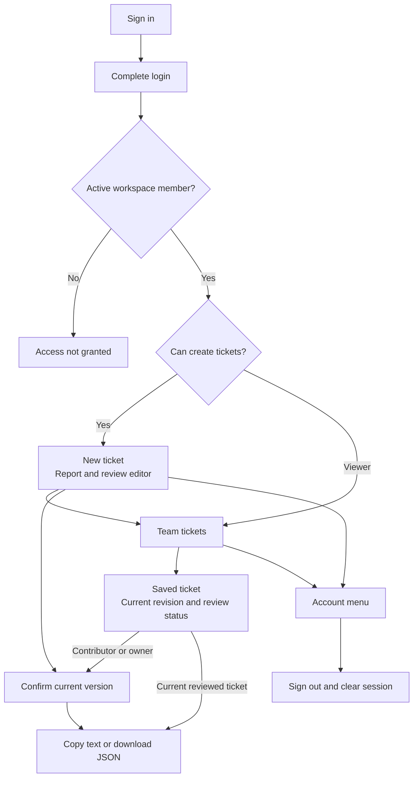
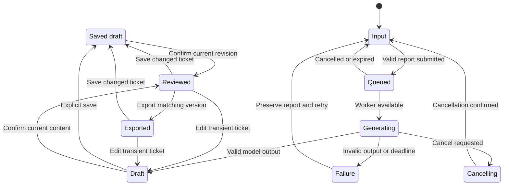

# BugBrief Product and Interface Design

Status: proposed screen and component specification. Updated: 13 October 2026.

BugBrief helps a support person turn a short report into a ticket that a developer can investigate. The interface should keep the source visible, make uncertainty easy to inspect, and give the user a clear path from draft to reviewed export. This document specifies that interface for the authenticated 10–20-user pilot.

Read [Architecutr.md](Architecutr.md) for platform choices, auth, data contracts, API routes, and deployment limits. A local React implementation now exists; see [Implementation.md](Implementation.md) for verification. The [v2 pipeline](V2_Pipeline.md) adds model readiness, source-comparison hints, and explicit review of title/observed meaning, expectation basis, environment, and reported steps within the existing charcoal workspace.

## 1. Design brief and decision status

| Topic | Decision | Status |
| --- | --- | --- |
| Visual direction | Dark developer workspace; charcoal and grey surfaces; compact layout | User selected |
| Accent | Restrained teal for primary actions and focus | Proposed in response to requested suitable accent |
| Main task | Paste report, draft, compare, edit, review, export | Required by project brief |
| Team use | Invite-only shared workspace for support, QA, and developers | User accepted recommendation |
| Login | Continue with Google through Supabase | User accepted recommendation |
| Saved history | Explicitly saved team tickets; unsaved drafts remain private | User accepted recommendation |
| Original report retention | Off by default; separate opt-in on save | User accepted no automatic saving |
| Product | Fictional LedgerFlow; synthetic reports | Confirmed pilot scope |
| Branding | Simple BugBrief wordmark; no mascot | Proposed; no supplied logo |

The primary screen is a working tool, not a marketing landing page. Use clear labels, real information density, and quiet surfaces. The dark theme should resemble a readable issue editor, without code-terminal styling applied to ordinary prose.

## 2. Users and navigation

| User | Main goal | Default access |
| --- | --- | --- |
| Support contributor | Prepare a clear ticket and identify missing facts | Draft, edit, review, save, export |
| QA/developer viewer | Inspect and export reviewed tickets | Read team history and export reviewed versions |
| Workspace owner | Control team access and pilot operation | Contributor actions; trusted dashboard membership administration |

Only show navigation appropriate to the role. A hidden button is not an access check; the backend enforces the role matrix in the architecture document.

Rendered diagram: [Navigation SVG](diagrams/navigation.svg).



Proposed routes: `/login`, `/auth/callback`, `/access-pending`, `/w/{workspaceId}/new`, `/w/{workspaceId}/tickets`, and `/w/{workspaceId}/tickets/{ticketId}`. Account actions open a small menu. Initial membership management stays in the trusted Supabase dashboard; do not display an unimplemented invite-users screen.

## 3. Visual system

### Color palette

| Token | Value | Use |
| --- | --- | --- |
| `--bg` | `#14171A` | Application canvas |
| `--surface` | `#1B2025` | Sidebar, report/editor surface |
| `--surface-raised` | `#242B32` | Input hover, menus, dialogs |
| `--input-bg` | `#171C21` | Editable controls |
| `--border` | `#39434D` | Quiet separators and panels |
| `--control-border` | `#71808F` | Input/button boundaries requiring clear visibility |
| `--text` | `#F1F5F9` | Main text and headings |
| `--text-secondary` | `#C2CBD4` | Supporting text |
| `--text-muted` | `#98A6B5` | Metadata and placeholders |
| `--accent` | `#5EEAD4` | Primary action background and focus |
| `--accent-hover` | `#99F6E4` | Primary hover |
| `--on-accent` | `#102521` | Text on primary buttons |
| `--accent-soft` | `#173C36` | Selected navigation background |
| `--success` | `#86EFAC` | Success text/icon |
| `--warning` | `#FCD34D` | Inferred label and recoverable warnings |
| `--danger` | `#FCA5A5` | Error text and destructive action labels |
| `--info` | `#93C5FD` | Reported-evidence label |

Use teal sparingly: one primary action, selected navigation, and focus outlines. The page remains mostly charcoal. Use a text label and icon with status color; color alone never conveys inferred, unknown, reviewed, or failed.

Do not use gradients, glass panels, oversized rounded cards, glow effects, floating decorative shapes, or animated backgrounds. Source and ticket panes are functional surfaces separated by borders, not decorative cards.

Verify actual token combinations before implementation acceptance. Text should meet at least 4.5:1 contrast, large text 3:1, and meaningful control/focus boundaries 3:1 against adjacent colors. The quiet separator token is decorative; interactive controls use the stronger boundary token.

### Typography

Use the system sans-serif stack for the initial version. It is free, familiar, and does not require external font requests:

```css
--font-ui: -apple-system, BlinkMacSystemFont, "Segoe UI", Roboto,
  "Helvetica Neue", Arial, sans-serif;
--font-mono: ui-monospace, SFMono-Regular, Menlo, Consolas,
  "Liberation Mono", monospace;
```

Use monospace only for an optional JSON export preview, revision IDs, and technical metadata. Customer reports, ticket descriptions, and questions use the UI font. If branding later needs a custom typeface, choose a verified open-license font, self-host WOFF2, preserve a fallback, and review the page again. No paid font is required.

| Style | Size / line-height | Weight | Use |
| --- | --- | --- | --- |
| Wordmark | 18 / 24 px | 650 | BugBrief brand |
| Page title | 24 / 32 px | 650 | New ticket, Team tickets |
| Section title | 16 / 24 px | 600 | Customer report, Ticket draft |
| Body/editor | 15 / 24 px | 400 | Report and descriptions |
| Label/button | 14 / 20 px | 600 | Fields and actions |
| Supporting text | 13 / 20 px | 400 | Hints, status, timestamps |
| JSON | 13 / 20 px | 400 | Technical export preview |

Use ordinary sentence case. Avoid spaced-out all-caps headings. On narrow screens, text inputs use at least 16 px to preserve comfortable input behavior and readability.

### Spacing, shape, and motion

- Spacing scale: 4, 8, 12, 16, 24, 32, and 48 px.
- Input/button radius: 6 px. Pane radius: 8 px. Dialog radius: 10 px.
- Input/button height: at least 40 px desktop and 44 px touch layouts.
- Form fields: 8 px label gap, 16 px between related fields, 24 px between sections.
- Icons: 16–18 px inside controls, 20 px in navigation; Lucide icons with consistent stroke.
- Focus: 2 px teal outline with 2 px offset. Never remove focus without a replacement.
- Hover/focus transitions: 120–160 ms; no pane entrance animation.
- Respect `prefers-reduced-motion`; loading state can use static status text when animation is reduced.
- Show a spinner only for real work. Never animate a fake progress percentage.

## 4. Layout and responsiveness

| Width | Layout |
| --- | --- |
| At least 1,200 px | 208 px sidebar; 48 px page padding maximum; source and ticket in two columns |
| 768–1,199 px | Compact 72 px navigation with accessible labels/tooltips; source above ticket |
| Below 768 px | Top app bar with navigation drawer; single column; no permanent sidebar |

The content area has a maximum width of 1,440 px. In desktop split view, use roughly 42% for the source and 58% for the ticket, with a 24 px gap and a minimum usable pane width of 360 px. If that cannot fit, stack the panes. Test the transition rather than forcing two narrow columns.

Use normal page scrolling initially. At desktop width, a sticky source heading and a bounded report pane can help comparison, but do not create three competing scrollbars. A sticky review/export action bar must leave bottom content padding and must not cover fields, errors, or the on-screen keyboard.

At 320 px viewport width, the main interface must not scroll horizontally. Tables become stacked rows with explicit labels. Only an optional JSON/code preview may scroll sideways. Support browser zoom up to 200% and text expansion without truncating essential labels.

## 5. Screen wireframes

These are layout diagrams, not rendered screenshots or an approved final UI. Bracketed text represents a control; explanatory notes do not become product copy.

### Sign in

```text
Charcoal canvas

                     BugBrief
                 Sign in to your workspace

             Prepare bug tickets with your team.

               [ Continue with Google ]

               Access is limited to invited members.
               Synthetic pilot for LedgerFlow.
```

Use a compact, centered sign-in surface no wider than 400 px. The wordmark and heading sit above one primary action. Do not add testimonials, fabricated customer logos, large illustration, or a second signup CTA.

While redirecting, disable duplicate activation and show “Opening Google sign-in…”. If the provider returns an error, show it beside the action with “Try again”. After an unauthorized login, show “Your account does not have access to this workspace. Contact your workspace owner.” with “Use another account” and “Sign out”. Do not collect access requests through a nonfunctional button.

### New ticket on desktop

```text
+------------------+------------------------------------------------------------+
| BugBrief         | LedgerFlow                         Account: name@example.com |
|                  | New ticket                                                  |
| > New ticket     | Turn a customer report into a ticket you can review.        |
|   Team tickets   |                                                             |
|                  | +------------------------+ +------------------------------+ |
| LedgerFlow       | | Customer report        | | Ticket draft                 | |
| Shared workspace | | [Paste report ...]     | | Awaiting a report            | |
|                  | |                        | |                              | |
|                  | | 0 / 4,000 characters   | | Your draft will appear here. | |
|                  | | [Use example v]        | |                              | |
|                  | | [Draft ticket]         | |                              | |
|                  | +------------------------+ +------------------------------+ |
| Synthetic pilot  |                                                             |
+------------------+------------------------------------------------------------+
```

Do not render an empty report field as a chat conversation. This product accepts one report at a time. The sample chooser has a few labeled synthetic examples; selecting one replaces input only after confirming if a report already contains text.

### Generated draft and review

```text
Customer report                       Ticket draft                 Draft
----------------------------------    ------------------------------------
Since yesterday, exporting invoices    Title
gives me an empty file ...             [Bulk invoice export produces ...]

Original report remains visible.       Product area
                                      [Billing v]                 Suggested
                                      Evidence: "exporting invoices ..."

                                      Actual behavior             Reported
                                      [Exporting several invoices ...]

                                      Expected behavior           Inferred
                                      [Export should include invoice data]
                                      Basis [Reported | Inferred | Unknown]

                                      Reported environment
                                      Browser [Chrome] Version [Not reported]
                                      OS [Not reported] App [Not reported]

                                      Reported steps
                                      No steps were supplied.

                                      Missing information
                                      Export format / Browser version / Count
                                      Follow-up questions 3 / 3
                                      [Which export format did you choose?]
                                      ...

                                      [Save draft]     [Review ticket]
```

Do not silently populate a full reproduction sequence from a symptom. A missing fact displays “Not reported” in the form, while the canonical JSON value remains null. Selecting a product area requires visible evidence or Unknown. An inferred expectation remains labeled after edits unless the user changes its basis and has supplied supporting context.

### Team ticket history

```text
Team tickets                                      [New ticket]
Saved tickets are visible to members of LedgerFlow.

[Search titles...]  [Area: All v]  [Status: All v]

Title                         Area       Status      Updated       By
Bulk invoice export ...       Billing    Reviewed    13 Oct, 14:10  Amina
Login returns to sign-in      Auth       Draft       13 Oct, 13:52  Ali

[Previous]                                            [Next]
```

Use a table on wide screens and a compact labeled list on narrow screens. History shows only saved tickets; it does not imply that every submitted report was retained. Default sort is most recently updated with stable pagination. Initial search is a bounded server-side title search; no semantic-search or vector service is required.

Opening a row loads a saved ticket with its revision, reviewer, timestamps, and whether the full source was retained. A viewer sees read-only fields and reviewed export controls. A contributor sees editing controls; saving changes invalidates the review and requires a new confirmation.

### Mobile

```text
[Menu] BugBrief                       [Account]
LedgerFlow
New ticket

Customer report
[Paste report ...]
[Use example]                   [Draft ticket]

Ticket draft
Title
[.........................................]
Product area [Billing v]
Evidence ...
Actual behavior ...
Expected behavior ...          Inferred
Environment ...
Questions ...

[Save draft]                  [Review ticket]
```

Once generation finishes, announce that the draft is ready and offer “Go to draft”; do not jump the page unexpectedly while the person is reading the source. Keep the source section available when the editor is below it.

## 6. Components and responsibilities

| Component | Responsibility | Required behavior |
| --- | --- | --- |
| `AppShell` | Navigation and workspace identity | Role-aware links; narrow-screen drawer; account cleanup |
| `AuthGate` | Route/session entry | Login, callback, loading, access-not-granted, expired session |
| `WorkspaceHeader` | Product and team context | Visible LedgerFlow name; no cross-workspace state reuse |
| `ReportInput` | One source report | Label, hint, character count, bounds, preserve input on failure |
| `ExamplePicker` | Synthetic examples | Label synthetic content; confirm replacement of existing input |
| `GenerationStatus` | Actual job state | Queued/running/cancelling/failed; busy/retry guidance |
| `TicketEditor` | Canonical ticket fields | Grouped semantic fields; nullable values; inline validation |
| `EvidenceExcerpt` | Product-area supporting text | Exact source quotation; Unknown state; source-unavailable state |
| `BasisControl` | Expectation classification | Reported/Inferred/Unknown with persistent text label |
| `EnvironmentFields` | Reported environment | Empty values map to null; no guessed browser/version |
| `StepList` | Reported reproduction details | Numbered supplied steps; null state; add/remove controls |
| `QuestionList` | Up to three follow-up questions | Count, duplicate feedback, add/remove, stable focus |
| `ReviewDialog` | Confirm exact candidate | Current revision summary; explicit confirmation; invalidation on edit |
| `SaveDialog` | Explain persistence | Shared team visibility; source retention unchecked by default |
| `ExportActions` | Reviewed version export | Copy text and JSON download; meaningful success/error feedback |
| `TicketTable` | Saved team history | Search/filter/pagination/empty/error states |
| `ConflictNotice` | Concurrent edit resolution | Preserve local changes; compare/reload; no silent overwrite |
| `ConfirmDialog` | Replace, leave, delete decisions | Specific action, clear cancellation, focus management |
| `InlineAlert` / `Toast` | Persistent failures / brief confirmations | Text and icon; correct live-region priority |

Build reusable button, input, textarea, select, field, badge, dialog, and menu primitives. Keep ticket validation and status transitions in the canonical backend rules; components consume typed outcomes. Do not introduce a general component framework solely for this small interface.

## 7. Interaction specification

### Input and generation

1. Focus the customer-report label/field on the New ticket screen.
2. Enable “Draft ticket” after basic input validity. Server tokenizer limits remain authoritative.
3. On submission, hold the current report and disable duplicate submission for that job. Preserve editable input only if changes are clearly a new candidate; initially lock it until cancel/finish to avoid mismatched source.
4. Show queued state with known queue position if available. Do not display an estimated wait until timings are measured.
5. When running, show “Preparing your draft…” and a cancel control.
6. Validate the complete response before filling the editor. Never display malformed JSON as an editable successful ticket.
7. Keep the source visible after success. On failure, retain the report and offer a manual retry.

If the person already has edited draft content, regenerating opens a specific confirmation: “Replace this draft? Your unsaved ticket edits will be lost.” The server must not overwrite the existing draft until a new valid result is ready.

### Editing and uncertainty

- Title, descriptions, environment, supplied steps, missing-information items, and questions are editable.
- Changing a reviewed ticket immediately switches its local status to “Changes need review”.
- For an unknown fact, render an empty control with a “Not reported” hint; do not store that display phrase as a fact.
- Product-area evidence is visible and editable only with source verification in the current session. An unsupported excerpt blocks known-area validation.
- An empty question list is allowed. Add controls stop at three and explain the limit; do not silently remove the fourth item.
- The original report is a separate source, not an editable model-generated field. Adding new customer information creates a new source candidate or an explicit edited-source flow, then requires drafting/review again.
- Do not show a fabricated confidence percentage or badge suggesting automatic factual verification.

### Save and review

Saving is optional. “Save draft” opens a compact dialog explaining: “This ticket will be visible to members of LedgerFlow.” A separate unchecked control says “Also save the original customer report.” Explain that extracted ticket text and evidence are retained when the ticket is saved.

Review requires an explicit user action and current validated content. The dialog says “Review this ticket” and asks the user to compare the draft with the source and check the inferred expectation. Its primary action is “Confirm reviewed version”. Do not precheck a confirmation box or imply that the model has already reviewed itself.

For a saved ticket, capture the exact revision being confirmed. For an unsaved ticket, capture the current content receipt. If the ticket changes before confirmation returns, retain the edits and show “The ticket changed. Review the current version.” The reviewed badge applies only to a matching candidate.

### Export

- After confirmation, enable “Copy ticket” and “Download JSON”.
- Copy exports the current reviewed text through the canonical formatter. Announce “Ticket copied” only after the clipboard operation succeeds.
- If clipboard permission is unavailable, offer selectable text with “Select and copy”; do not claim it was copied.
- JSON downloads use the canonical schema, with null values and at most three questions. A separate envelope may include review/model metadata if explicitly specified by the API.
- A browser download beginning is not evidence that the file was saved to disk. Use “Download started”, not “Saved to your computer”.
- Editing after export returns to needs-review state. Exporting again requires confirmation of the new content.
- Do not show a Jira button or “Created issue” confirmation in this MVP.

### Shared editing and deletion

When a save returns a revision conflict, keep local edits and show “Someone updated this ticket. Compare the latest version before saving.” Offer “View latest version” and “Keep my edits”. A comparison shows changed fields; overwrite requires a new deliberate action against the latest revision. No last-write-wins save.

Deletion uses a confirmation naming the ticket and explaining that its saved versions will be removed. Show only to the creator contributor or an owner. Remove the row only after the backend confirms deletion; failed deletion remains visible with retry guidance.

## 8. State machine and feedback

Rendered diagram: [UI states SVG](diagrams/ui-states.svg).



| Situation | Visible message | Available action |
| --- | --- | --- |
| No report | “Paste a customer report to prepare a ticket.” | Paste or use synthetic example |
| No generated draft | “Your draft will appear here.” | Enter report |
| Queued | “Your report is queued.” | Cancel; show actual position when known |
| Running | “Preparing your draft…” | Request cancellation |
| Cancelling | “Cancelling generation…” | Wait; never claim it has stopped early |
| Queue full | “The pilot is busy. Try again shortly.” | Retry after indicated delay |
| Provider/model unavailable | “Ticket drafting is unavailable right now.” | Keep report; retry later |
| Invalid generated JSON | “We couldn’t produce a valid ticket. Your report is still here.” | Try again |
| Report too long | “Shorten this report before drafting.” | Edit report; show actual limit |
| Expired login | “Your session expired. Sign in to continue.” | Sign in; preserve memory state where possible |
| Revoked/no membership | “Your account does not have access to this workspace.” | Use another account or sign out |
| Save succeeds | “Draft saved to LedgerFlow.” | Continue editing or review |
| Save fails | “The draft wasn’t saved. Your changes are still here.” | Retry save |
| Revision conflict | “Someone updated this ticket.” | Compare latest; keep edits |
| History empty | “No tickets have been saved yet.” | Contributor: New ticket; viewer: explanatory text |
| No filter matches | “No tickets match these filters.” | Clear filters |
| History unavailable | “We couldn’t load team tickets.” | Retry without hiding existing local work |
| No retained source | “The original report was not saved with this ticket.” | Review available ticket; do not claim source comparison |
| Source unavailable after refresh | “This unsaved report is no longer available.” | Paste report again |

Errors affecting a form stay inline until resolved. Toasts are for brief, confirmed outcomes. Use `aria-live="polite"` for queue/result status and an assertive alert for a blocking failure when needed. Never rely on a disappearing toast for the only explanation of a failed save or export.

## 9. Accessibility and keyboard use

- Use native buttons, inputs, textareas, selects, and headings with associated labels.
- Keep focus order aligned with reading order: navigation, report, generation, ticket fields, save/review, export.
- Every icon-only button needs an accessible name and a tooltip for sighted users.
- Announce completed generation without moving focus unexpectedly. Provide “Go to draft” when useful.
- Dialogs trap focus, support Escape when cancellation is allowed, and restore focus to the invoking control.
- Dynamic item removal moves focus to the neighboring item or Add control; never lose focus to the document root.
- Field errors link to their controls; a validation summary focuses the first invalid field on submission.
- Do not invent application-wide single-letter shortcuts. Ordinary typing, Enter/Space activation, and Tab navigation remain predictable.
- Disabled controls explain why they are disabled nearby; use a readable treatment rather than illegible opacity.
- Test dark-theme contrast, reduced motion, 200% zoom, 320 px width, screen-reader names, and touch controls.
- Browser native cursor is preserved. No companion, imitation cursor, or persistent overlay is part of this design.

## 10. Product language

Use plain language for support staff. Prefer “Ticket draft”, “Reported”, “Inferred”, “Not reported”, “Review ticket”, and “Download JSON”. Technical JSON and model revision details belong in an optional details panel rather than the main task.

The interface may say “Suggested product area” because the model proposes it. It must not say “Root cause found”, “Guaranteed accurate”, or “Production ready”. Show a short persistent label “Synthetic LedgerFlow pilot”. Keep free-hosting quota and technical errors in useful status messages, not a large overlay covering the editor.

Privacy copy must match the implemented behavior:

> Reports are processed to prepare a draft. Unsaved reports are not stored in ticket history. Saving a ticket shares its contents with this workspace. You can choose whether to include the original report.

This wording is valid only after the storage, logging, and retention behavior in the architecture document is implemented and verified. In a nonfunctional design prototype, use “Design preview” and label sample outputs as synthetic. Do not present a simulated generation or save as a real action.

## 11. Frontend state boundaries

| State | Scope | Reset rule |
| --- | --- | --- |
| Auth session | Current browser session | Logout/account change |
| Workspace and role | Verified API session response | Membership change/workspace change |
| Customer report | Current user/workspace, memory only | Explicit clear, new report, logout/tab close |
| Generation job | Creating user/workspace | Terminal state, expiry, account switch |
| Edited ticket | Ticket and revision | Explicit replacement; preserve on save failure/conflict |
| Reviewed candidate | Exact revision or content receipt | Any edit, expiry, unauthorized state |
| History filters | Current workspace | Workspace/account change |

Do not store customer text in URL parameters, browser analytics events, global cross-account caches, or localStorage. A route change within the same workspace may preserve in-memory edits; leaving the page with unsaved changes asks whether to leave or keep editing. Browser refresh/tab close may lose transient data, and the UI must explain that accurately. Automatic persistent drafts are outside this pilot.

Use request cancellation and request identity checks so a stale generation response cannot fill a new user's or another workspace's editor. An API failure never clears a report, marks a ticket saved, or advances review state. Render model and customer strings as plain text; do not execute HTML, Markdown links, scripts, or generated instructions.

## 12. Design implementation tasks

| Task | Output | Acceptance evidence |
| --- | --- | --- |
| D1. Define tokens and primitives | Color, type, spacing, Button, Field, Dialog | Contrast and keyboard checks |
| D2. Build app shell and auth surfaces | Login, callback, pending access, navigation | Desktop/mobile role-aware navigation |
| D3. Build report input | Bounds, count, synthetic examples, generation action | Replace confirmation; retained report on error |
| D4. Build ticket editor | Canonical fields and visible uncertainty | Null values, three-question limit, field errors |
| D5. Connect job states | Queue/running/cancel/failure/result | Real API outcomes; no fake progress |
| D6. Build save and review dialogs | Shared visibility, source opt-in, exact candidate | Review invalidation and source-retention checks |
| D7. Build export actions | Copy text, JSON download, clipboard fallback | Only reviewed matching content exported |
| D8. Build team history/detail | Search, filters, pagination, role restrictions | Empty/error/read-only states |
| D9. Build shared-edit conflict handling | Preserve/compare/reload flow | Two contributors cannot overwrite silently |
| D10. Verify the deployed interface | Actual browser, mobile width, keyboard, zoom | Screenshots and observed behavior from the real build |

## 13. Questions to resolve before implementation

The initial conversation established the dark palette and free notebook training. The following details materially affect the product and remain open:

1. Google login is accepted. Identify the initial invited accounts and confirm they can use it.
2. Shared saved tickets are accepted. Which people need contributor access, viewer access, and owner access?
3. No automatic saving of original reports is accepted. Should an explicit source-save option remain, and is the proposed 30-day owner review of pilot data suitable?
4. An eligible Hugging Face account is available. Does its ZeroGPU trial pass adapter/quota checks, and can the owner obtain an Oracle A1 VM if the full team API needs that route?
5. Is a queued CPU pilot acceptable, or is immediate response for many simultaneous users required?
6. Is there an existing software-house logo or brand system to use? Until supplied, use the simple BugBrief wordmark and proposed teal accent.

These questions do not prevent a reviewable design specification. Google login and shared access are settled; role assignments, detailed retention, and deployment feasibility still need resolution before their implementation.

## 14. Design acceptance

- [ ] User can identify the source, inferred expectation, and missing facts without opening technical JSON.
- [ ] The charcoal layout stays readable and the accent directs attention to the current primary action.
- [ ] All visible controls perform their stated action; samples and previews are labeled.
- [ ] Drafting, saving, reviewing, and exporting have distinct accurate states.
- [ ] Save visibility and optional source retention are explained before persistence.
- [ ] An edit invalidates review and a shared edit conflict preserves local work.
- [ ] Viewers cannot see enabled edit/create actions; backend tests enforce the same restrictions.
- [ ] Login, unauthorized access, queue saturation, malformed output, and network failures have useful recovery paths.
- [ ] Desktop, narrow-screen, keyboard, zoom, contrast, and reduced-motion checks pass on the real UI.
- [ ] No product copy claims deployment, measured performance, or model accuracy before corresponding evidence exists.
