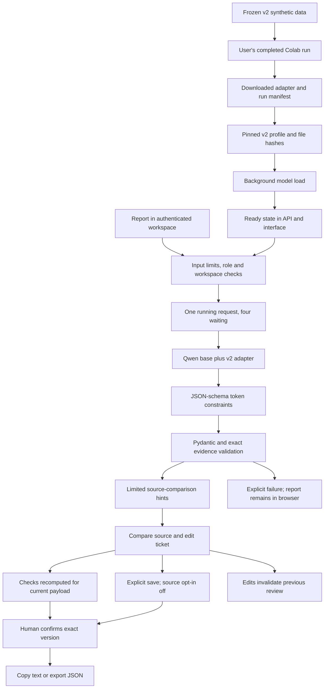

# BugBrief v2 application pipeline

The local pipeline uses the downloaded `bugbrief-qlora-02` adapter with its pinned Qwen base model. It keeps drafting, automated review hints, human review, saved history, and export as separate steps. V2 remains experimental: constrained output and source checks do not establish factual accuracy.

The [local runtime review](V2_Runtime_Review.md) records real inference results. The INT8 workflow completed with poor content; the selected float32 runtime rejected a fresh-worded report for invalid evidence and also showed factual errors. The pipeline is implemented, but this adapter has not passed a factual release evaluation.

## Run on this computer

The project uses the existing `.venv`, Node package locks, and local SQLite workspace. Google/Supabase authentication remains available in production mode; the current local workspace uses loopback-only development access and does not simulate Google login.

From the project root in PowerShell:

```powershell
# One-time CPU runtime installation; keep this separate from the small API dependency lock.
.\.venv\Scripts\python.exe -m pip install torch==2.11.0 --index-url https://download.pytorch.org/whl/cpu
.\.venv\Scripts\python.exe -m pip install -r backend/requirements-model.in

.\.venv\Scripts\python.exe scripts/configure_v2.py
.\.venv\Scripts\python.exe scripts/check_v2.py
npm.cmd run dev
```

Open `http://127.0.0.1:5173` and choose **Open local workspace**. Wait for the model to become ready, then paste a short report or select a synthetic example. The first startup downloads approximately 3 GB of public base weights into the Hugging Face cache. The adapter alone is not a complete model. CPU loading and generation can be slow on the two-core laptop; a 600-second generation limit is configured for this first local setup. This does not establish 10–20-user throughput.

`configure_v2.py` verifies the adapter, preserves existing auth/database settings, backs up the original local configuration as `backend/.env.pre-v2` once, and selects `models/v2.json`. It never prints credentials. Local `.env` files and downloaded adapter folders are ignored by Git. Stop and restart the dev runner after changing configuration.

## Runtime flow



The server is available while the model loads. `/health/live` checks the API process; `/health/ready` returns 503 until drafting is ready. `/v1/config` exposes a safe model state and profile name. It does not expose local adapter paths or credentials. The interface refreshes loading status and distinguishes fixed synthetic example mode from real adapter inference. Initialization errors are logged locally and shown as a failed model state, without a fallback to simulated results.

## Artifact identity and generation

`models/v2.json` records SHA-256 hashes for the adapter weights, adapter configuration, and training run, plus the base model and full commit and trained prompt hash. Loading verifies those values against the downloaded export and the canonical serving prompt/schema. Changing LoRA scaling or other adapter settings also fails verification. It reads JSON and safetensors; it does not load `training_args.bin`. A changed or missing artifact fails startup. The model is labelled experimental even when it is technically ready.

The local default uses float32 weights and the PEFT adapter with `MODEL_CPU_QUANTIZATION=none`. The API uses two Torch threads, one loaded model, and greedy generation. The pinned base-weight file was downloaded and its complete SHA-256 verified before the real-model checks.

`MODEL_CPU_QUANTIZATION=int8` is an optional [PyTorch dynamic INT8](https://docs.pytorch.org/docs/main/generated/torch.ao.quantization.quantize_dynamic.html) variant. It merges the adapter in RAM and quantizes CPU linear layers; original files remain untouched. Its metadata records `quantization=dynamic_int8`. In the first local synthetic invoice-export test, this variant returned a structurally valid but poor ticket with an unspecified title, Unknown area, and no actual behavior. It is not the selected default. That one observation does not establish the cause or an accuracy percentage. Conversion also requires temporary memory for the float32 model. Any quantized variant needs separate factual evaluation.

`MODEL_DEVICE` can be `cpu`, `cuda`, or `auto`; CUDA BF16 selection checks native support rather than emulation. CPU quantization is not applied on CUDA. CUDA is not available on this computer. `GENERATION_TIMEOUT_SECONDS` can be 10–1800; the default configured by the helper is 600.

`CONSTRAINED_OUTPUT=true` uses [LM Format Enforcer's Transformers integration](https://github.com/noamgat/lm-format-enforcer) with the canonical Pydantic JSON schema. This constrains structure during decoding. Pydantic semantic validators and exact evidence-substring checks still run afterwards; token limits, cancellation, or semantic mismatches can still fail a request. The serving prompt remains the one used during v2 training. The adapter's saved unconstrained validation percentages do not establish this runtime's constrained-generation quality.

Cancellation and time limits are checked between model token steps. They cannot interrupt a single in-progress CPU operation immediately. The queue remains bounded, rate limits and idempotency binding remain enforced, and only the owning user/workspace can access each unsaved job. Use one API worker; jobs and review receipts are held in process memory.

## Source comparison and human review

`backend/app/quality.py` is the canonical implementation of review hints. It checks for selected loss/retention contradictions, Reported expectations without explicit intent markers, inferred goals for vague reports, product areas without recognizable source markers, unsupported environment quotations, OS names in browser versions, and steps needing source comparison. It never rewrites a ticket or certifies it as factually correct. Paraphrases and context can produce false positives; the checks also miss errors.

Initial findings accompany a successful generation job. `POST /v1/workspaces/{workspace_id}/draft-checks` recomputes findings for the current edited payload using a source retrieved from an authorized job or saved ticket. The caller supplies exactly one `job_id` or `ticket_id`, plus `payload`; it cannot supply a different report to justify a draft. Missing saved source is reported explicitly. Findings are displayed above the editor and refresh after edits. Human review asks the reviewer to check the title's meaning, observed behavior, expectations, environment, and reported steps.

The existing server review/export controls remain authoritative: unsaved export requires a receipt bound to the exact payload and workspace/user; saved export requires the exact reviewed revision. Edits invalidate review. The additional interface checkbox is a review aid, not a new security boundary or proof of human identity.

Saving a draft records the generation's immutable model/pipeline metadata, including the pinned adapter identity. Source retention remains opt-in. Extracted facts and exact evidence excerpts still persist with the ticket even when the full original report is not saved. A reopened source-free ticket cannot receive a complete source comparison.

## Verification tools

```powershell
# Artifact/prompt identity only; no model allocation or generation.
.\.venv\Scripts\python.exe scripts/check_v2.py

# Replay limited checks over downloaded, unconstrained validation outputs.
.\.venv\Scripts\python.exe scripts/replay_v2.py

# Real-model API test using an isolated in-memory database and a synthetic report.
# Stop the dev runner first to avoid loading two copies of the model.
.\.venv\Scripts\python.exe scripts/check_v2.py --live

npm.cmd run build
npm.cmd run test:database
cd backend
..\.venv\Scripts\python.exe -m pytest -q
```

Evidence files are written under `ml/artifacts/` and refuse silent overwrites; pass a new `--output` filename for another run. The live test covers real generation, authenticated job access, source checks, saving without the original report, model provenance, review-before-export, JSON export, and edit invalidation. Its review actions are automated test operations in a disposable in-memory database, not human factual review.

The selected float32 runtime currently fails that fixed fresh-worded report because its evidence quote is unsupported. The command records the rejected synthetic output and fails; it does not skip the guard. A separate browser check successfully reproduced an exact training report, then verified editing and review controls. Both outcomes are documented in the runtime review.

Replay is labelled `saved_unconstrained_output_replay`, not fresh inference. In the downloaded 50 adapter outputs, strict validation rejects four outputs; review checks flag all nine known reversed invoice titles and the three known reversed actual-behavior fields (12 field findings). This demonstrates detection on those saved cases, not exhaustive factual validation.

## Team and hosting continuation

This computer-first setup is not public hosting. To enable real Google login and shared PostgreSQL persistence, follow the root README's Supabase setup, fill the existing environment files locally, switch `BUGBRIEF_MODE=production`, configure redirect URLs and initial memberships, and verify hosted OAuth/JWKS/PostgREST. Those services have not been connected in this local setup.

The API container and Cloudflare Pages instructions remain in `deploy/`. A hosted profile requires the full exported run, adapter files, a matching profile path/hash, a writable base-model cache, explicit origins, HTTPS, and measured capacity. No cloud resources are provisioned by the local configuration helper. Model readiness and unit checks are separate from a release decision; retain factual review and use independent reports before inviting the whole pilot.
